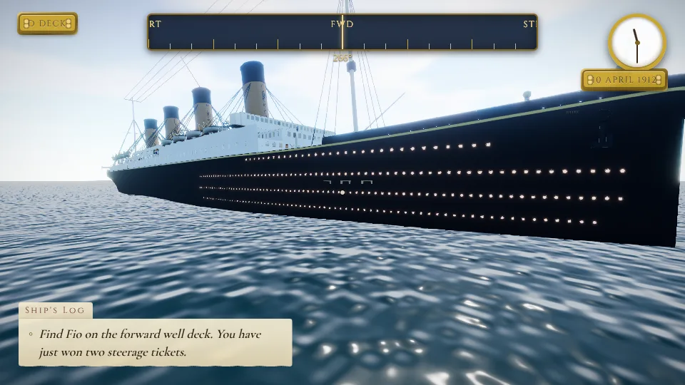
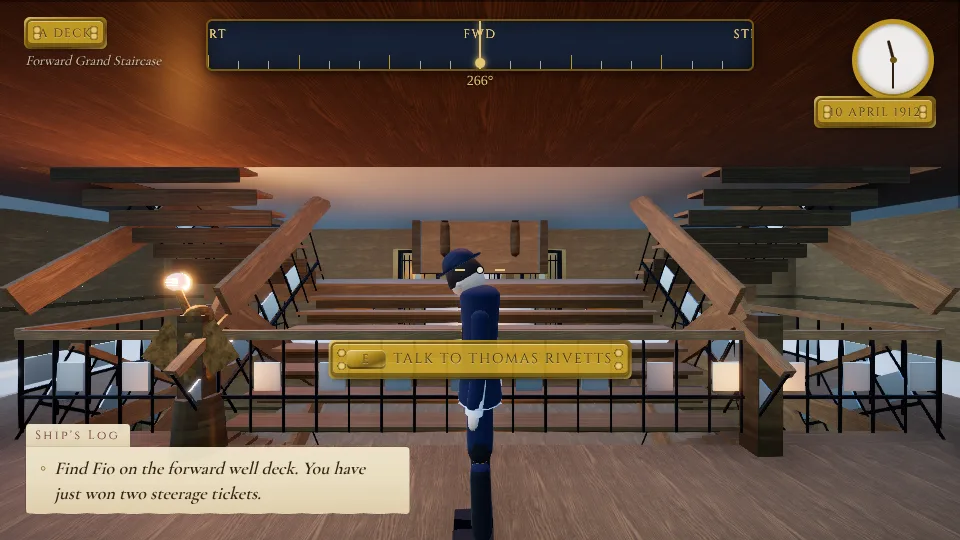
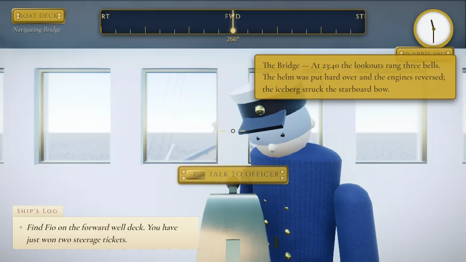
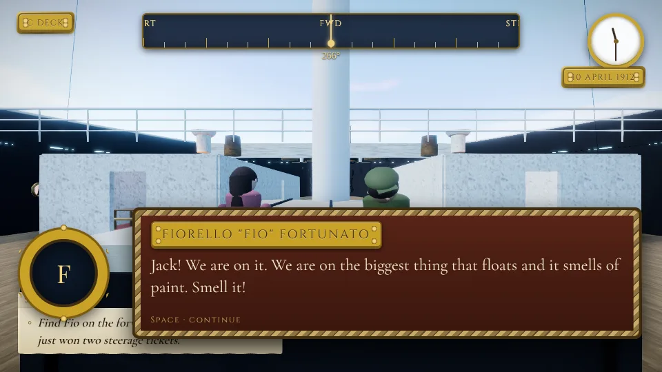
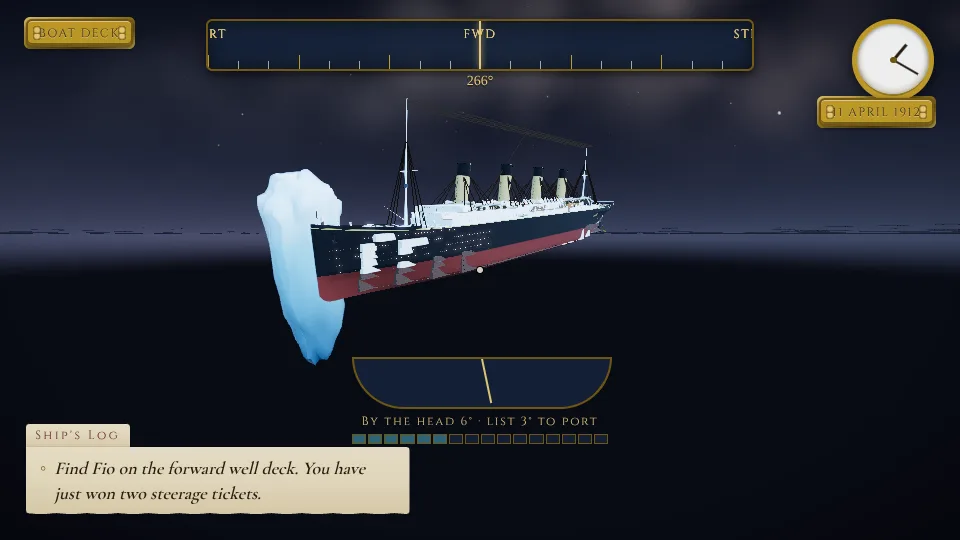

# A Night to Remember Forever

A free-roam 3D recreation of **RMS Titanic** (10–15 April 1912) that runs in the browser, built
with Three.js for 4K. The ship is generated procedurally from a research-derived specification
(`src/data/shipSpec.js`: Board of Trade deck heights, 1911 Harland & Wolff general arrangement,
156 named rooms, bulkheads A–P, funnels, lifeboats, machinery) and dressed with PBR materials.
The story is a parody homage to the 1997 film — four "watches" from Southampton to the
debris field, with changed names (Jack Dawkins, Rosie DeWitt Bukater-Fitzgerald, Cal
Hockney-Spline, "Unsinkable" Dolly Brown…). The ship, the night and the people lost on it are
real; discovery plaques quote documented history only.



| | |
| --- | --- |
|  |  |
|  |  |

## Running it

Requirements: Node 20+ and a browser with WebGL 2 (Chrome, Edge or Firefox; a discrete GPU for 4K).

```bash
cd titanic
npm install
npm run dev          # http://localhost:5173  (LAN access is on: --host)
```

Production build and local preview:

```bash
npm run build        # dist/
npm run preview      # serves dist/ on http://localhost:4173
```

### Putting it on an external drive

Clone (or copy) the repository onto the drive, then run the commands above from the
`titanic` folder there. Everything the game needs — textures, fonts, build tooling — lives
inside this folder; `npm install` creates `node_modules` next to it. Saves and settings are
kept in the browser's local storage (`titanic.save.v1`, `titanic.settings.v1`).

```bash
# example: D:\ on Windows, /Volumes/External on macOS
git clone --branch claude/tender-gauss-ew1pal https://github.com/emsabando/Store-GPS.git
cd Store-GPS/titanic && npm install && npm run dev
```

## Controls

| Action | Keys |
| --- | --- |
| Walk / run / jump / crouch | `W A S D` (arrows) · `Shift` · `Space` · `C` |
| Look | mouse (click the viewport to take the helm; `Esc` releases it) |
| Interact / talk / sit / open doors | `E` |
| Flashlight (after the lights fail) | `F` |
| Deck plan (blueprint, teleport by pin) | `Tab` or `M` |
| Ship's log (journal, discoveries, manifest) | `J` |
| Chronometer (advance the watch) | `T` |
| First / third person | `V` |
| Photo mode · screenshot | `P` · `C` |
| Save / load | `F5` / `F9` |
| Pause, settings, quit to menu | `Esc` |

Gamepads work too (left stick walk, right stick look, `A` jump, `X` interact, `Y` flashlight).

## URL parameters (testing)

`?autostart=1` skips the menu · `quality=low|medium|high|ultra` · `res=native|1080p|1440p|4k` ·
`scale=0.5…1` render scale · `at=<location id>` spawn point · `time=HH:MM` · `watch=watch1…watch4` ·
`nosink=1` never sinks · `debug=1` exposes `window.__game` (teleport, setTime, startSinking, frame…) ·
`manual=1` manual render mode for screenshots.

## Tests and tooling

```bash
npm run check                 # bundles src/main.js in memory and reports unresolved modules
node --test tests/unit/*.mjs  # story / character / NPC data tests
node tests/shot.mjs --locations=bridge,grand_staircase_A --w=1920 --h=1080 --out=screenshots/mine
node tests/shot.mjs --locations="exterior_port_bow,120:5:40:2.27:-0.05" --sink=100 --at=poop_deck --calls   # free camera, sinking, draw-call stats
npm run smoke -- --4k         # full build + headless 4K screenshots of every landmark
```

The headless harness uses the pre-installed Playwright Chromium with SwiftShader, so it is
slow (about a second per 1080p frame) but needs no GPU.

## Layout

```
src/core        Engine (renderer, post pipeline, quality presets), Events, Input, Settings
src/ship        Hull, Decks, Superstructure, Props, interiors (Grand Staircase, public rooms,
                cabins, machinery), Ship orchestrator (collision BVH, light pool, break-up)
src/world       Sky (Preetham + night dome), Environment (PMREM, fog, exposure), Ocean, Iceberg
src/player      Capsule controller, interaction, camera, character costumes
src/npc         Crowds and named characters, behaviours
src/story       Quest manager, dialogue runner; data in src/data (story, dialogue, characters)
src/sinking     SinkingDirector: trim/list timeline, flooding, break-up, funnel collapse
src/audio       WebAudio synthesiser: ambience, footsteps, the band, the ship's whistle
src/ui          Nautical UI: HUD (compass tape, chronometer, deck plate), wheel menu, panels
research/       Source notes: dimensions, deck-by-deck plans, interiors and materials
design/         Story & characters, UI/UX specification
```

See `ARCHITECTURE.md` for the module contract (ship-local frame, builders, event bus, debug API).

## Credits

Textures: ambientCG and Poly Haven (CC0), see `public/textures/LICENSES.md`. Fonts: Playfair
Display, Cormorant Garamond and Cinzel (SIL OFL), see `public/fonts/LICENSES.md`. Libraries:
three.js, postprocessing (pmndrs), N8AO, three-mesh-bvh.

In memory of the 1,496.
